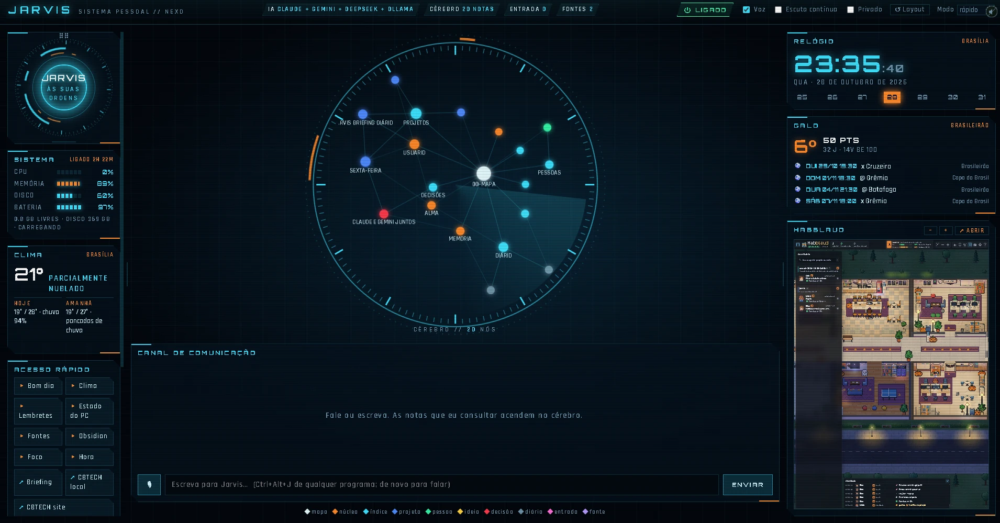
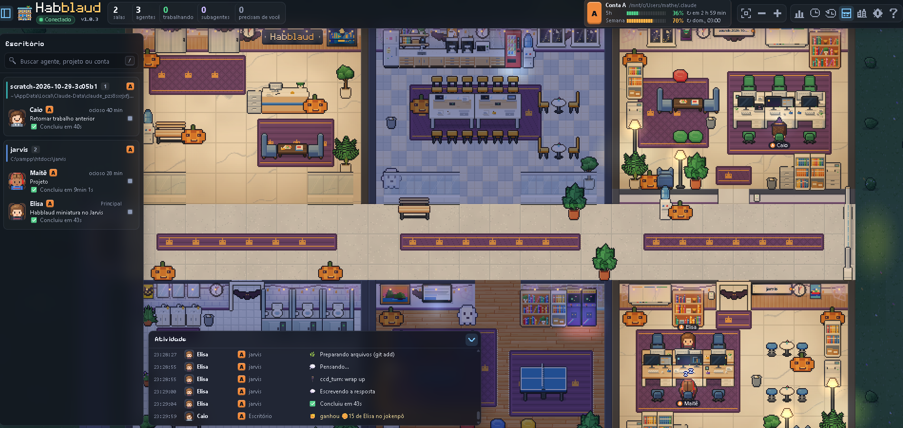

<div align="center">



# 🤖 J.A.R.V.I.S — Sistema Pessoal // NEXO

**⚡ Às suas ordens.** Um painel HUD futurista que junta várias IAs, um cérebro de notas, voz e o estado do seu dia em uma única tela.


</div>

---

## 🛰️ Visão geral do painel

<div align="center">
  
  <br/>
  <sub>▸ Interface principal: núcleo, cérebro em grafo, canal de comunicação e widgets.</sub>
</div>

---

## 🏢 Habblaud: o escritório dos agentes

<div align="center">
  
  <br/>
  <sub>▸ Habblaud: cada projeto vira uma sala, cada sessão do Claude Code vira um personagem, e o feed mostra o que cada um está fazendo.</sub>
</div>

O **[Habblaud](https://github.com/marmottajr/habblaud)** é um escritório virtual em pixel art que mostra, em tempo real, o que os agentes do Claude Code (e do Codex) estão fazendo: quem está trabalhando, quem está ocioso, quem precisa de você, o uso de 5 horas e semanal de cada conta e o feed de atividade.

No JARVIS ele aparece **ao vivo dentro do painel**, num quadro da coluna lateral. A miniatura mostra a lista **Escritório**, o mapa e o feed **Atividade**. Dá para aproximar, afastar e mover o mapa ali mesmo, e o botão **↗ ABRIR** leva ao Habblaud inteiro. A instalação e o funcionamento estão em [🏢 14. Habblaud no painel](#-14-habblaud-no-painel).

> 📦 O código-fonte do Habblaud está em [`habblaud/`](habblaud/): versão **1.0.3** (commit `faa1a01`), copiada sem alterações do repositório original. © 2026 Márcio Junior, licença **MIT** ([`habblaud/LICENSE`](habblaud/LICENSE)).

---

## 🦾 Módulos do sistema

| Módulo | Função |
|:------:|--------|
| 💠 **Núcleo JARVIS** | Anel animado que mostra se o assistente está ligado, ouvindo ou respondendo |
| 🧠 **Cérebro** | Grafo das notas (20 nós). As notas consultadas pela IA **acendem** durante a resposta |
| 🔀 **Multi-IA** | Roteia os pedidos entre **Claude**, **Gemini**, **DeepSeek** e **Ollama** (modelo local) |
| 📡 **Canal de comunicação** | Chat por texto ou voz com o JARVIS |
| 🎙️ **Voz** | Fala e escuta. Atalho global **Ctrl + Alt + J** em qualquer programa |
| 🛡️ **Modo privado** | Usa só o modelo local (Ollama). Nada sai do computador |
| ⚙️ **Sistema** | CPU, memória, disco e bateria em tempo real |
| 🕹️ **Acesso rápido** | Bom dia, Clima, Lembretes, Estado do PC, Fontes, Obsidian, Foco, Hora, Briefing, CBTECH |
| 🕒 **Relógio** | Hora de Brasília e mini-calendário da semana |
| 🌦️ **Clima** | Temperatura atual e previsão para hoje e amanhã |
| 🔋 **Hábitos** | Anel de progresso dos 4 pilares: Projeto principal, Conteúdo (YouTube), Saúde, Relacionamentos |
| ⏰ **Lembretes** | Lista de lembretes agendados |
| ⚽ **Galo** | Posição e pontos do Atlético-MG no Brasileirão e próximos jogos |

### 🧬 Tipos de nó no cérebro

`⬜ mapa` · `🟧 núcleo` · `🟦 índice` · `🔵 projeto` · `🟩 pessoa` · `🟨 ideia` · `🟥 decisão` · `⬛ diário` · `🩷 entrada` · `🟪 fonte`

---

## 🎛️ Controles da barra superior

| Controle | O que faz |
|----------|-----------|
| `⏻ LIGADO` | Liga e desliga o JARVIS |
| `☑ Voz` | Liga a resposta falada |
| `Jarvis ▾` | Escolhe a voz das respostas faladas |
| `☐ Escuta contínua` | Mantém o microfone aberto sem precisar do atalho |
| `☐ Privado` | Força o uso apenas do modelo local |
| `Modo: rápido` | Escolhe entre respostas rápidas e respostas mais elaboradas |

---

## 📘 Manual de Implementação

**🛠️ Guia para instalar, configurar e colocar o sistema no ar, passo a passo.**

> ⚠️ **Antes de começar:** os comandos de instalação dependem da linguagem do seu projeto. Os nomes de pastas e variáveis abaixo são uma **referência**. Ajuste ao que já existe no seu código.

**📑 Sumário**

1. [🧭 Arquitetura](#-1-arquitetura)
2. [🔋 Pré-requisitos](#-2-pré-requisitos)
3. [📥 Instalação](#-3-instalação)
4. [🔑 Chaves e variáveis de ambiente](#-4-chaves-e-variáveis-de-ambiente)
5. [🦙 IA local com Ollama](#-5-ia-local-com-ollama)
6. [🔀 Roteamento entre IAs](#-6-roteamento-entre-ias)
7. [🧠 Cérebro (notas do Obsidian)](#-7-cérebro-notas-do-obsidian)
8. [🎙️ Voz e atalho global](#️-8-voz-e-atalho-global)
9. [📊 Widgets do painel](#-9-widgets-do-painel)
10. [🚀 Executando](#-10-executando)
11. [✅ Checklist de verificação](#-11-checklist-de-verificação)
12. [🩺 Solução de problemas](#-12-solução-de-problemas)
13. [🛡️ Segurança](#️-13-segurança)
14. [🏢 Habblaud no painel](#-14-habblaud-no-painel)

### 🧭 1. Arquitetura

```
┌─────────────────────────────────────────────────────────────┐
│                     🖥️  INTERFACE HUD                        │
│  Núcleo · Cérebro (grafo) · Canal · Widgets · Acesso rápido │
└──────────────┬──────────────────────────────┬───────────────┘
               │ mensagens / voz              │ dados dos widgets
┌──────────────▼──────────────┐  ┌────────────▼───────────────┐
│     🔀 ROTEADOR DE IA        │  │     📡 SERVIÇOS            │
│  Claude · Gemini · DeepSeek │  │  Sistema · Clima · Futebol │
│  Ollama (local / privado)   │  │  Hábitos · Lembretes       │
└──────────────┬──────────────┘  └────────────────────────────┘
               │ consulta notas
┌──────────────▼──────────────┐
│   🧠 CÉREBRO (Obsidian)      │
│  Notas .md → nós e ligações │
└─────────────────────────────┘
```

**Fluxo de uma pergunta:**
1. Você fala ou digita no **Canal de comunicação**.
2. O **roteador** escolhe a IA de acordo com o modo (rápido, elaborado ou privado).
3. A IA consulta as notas do **cérebro**, e os nós usados **acendem** no grafo.
4. A resposta aparece no canal e, se **Voz** estiver ligada, é falada.

---

### 🔋 2. Pré-requisitos

| Item | Para quê |
|------|----------|
| 💻 Windows 10/11, macOS ou Linux | Sistema operacional |
| 🟢 Node.js 20+ **ou** 🐍 Python 3.11+ | Rodar o backend (o que o projeto usar) |
| 🦙 [Ollama](https://ollama.com) | IA local e modo privado |
| 🗃️ [Obsidian](https://obsidian.md) | Pasta de notas que vira o cérebro |
| 🎙️ Microfone e alto-falante | Comandos de voz |
| 🔑 Chaves de API | Claude, Gemini e DeepSeek |

---

### 📥 3. Instalação

```bash
# 1. Clonar
git clone <url-do-repositorio> jarvis
cd jarvis

# 2. Instalar dependências (use a linha do seu projeto)
npm install                       # se for Node.js
pip install -r requirements.txt   # se for Python

# 3. Criar o arquivo de configuração
cp .env.example .env
```

---

### 🔑 4. Chaves e variáveis de ambiente

Preencha o `.env` (exemplo de nomes; use os que o seu código lê):

```env
# ===== 🤖 IAs na nuvem =====
ANTHROPIC_API_KEY=sua-chave-claude
GEMINI_API_KEY=sua-chave-gemini
DEEPSEEK_API_KEY=sua-chave-deepseek

# ===== 🦙 IA local =====
OLLAMA_URL=http://localhost:11434
OLLAMA_MODEL=llama3.1

# ===== 🧠 Cérebro =====
OBSIDIAN_VAULT=C:/Users/SEU_USUARIO/Documents/Cerebro

# ===== 🌦️ Clima =====
CIDADE=Brasília
LATITUDE=-15.78
LONGITUDE=-47.93

# ===== ⚽ Futebol =====
TIME=Atlético-MG
FOOTBALL_API_KEY=sua-chave

# ===== 🎙️ Voz =====
ATALHO_VOZ=Ctrl+Alt+J
```

**Onde conseguir as chaves:**
- 🟠 Claude → [console.anthropic.com](https://console.anthropic.com)
- 🔵 Gemini → [aistudio.google.com](https://aistudio.google.com)
- 🐋 DeepSeek → [platform.deepseek.com](https://platform.deepseek.com)

> 🛡️ O `.env` **nunca** deve ir para o GitHub. Confirme que ele está no `.gitignore`.

---

### 🦙 5. IA local com Ollama

```bash
# Instale pelo site e depois baixe um modelo
ollama pull llama3.1

# Teste
ollama run llama3.1 "Olá, JARVIS"
```

O Ollama fica disponível em `http://localhost:11434`. Com a opção **Privado** marcada no painel, o JARVIS deve usar **somente** esse modelo.

---

### 🔀 6. Roteamento entre IAs

Lógica sugerida para decidir quem responde:

| Situação | IA |
|----------|----|
| 🛡️ **Privado** ligado | 🦙 Ollama (sempre) |
| ⚡ Modo **rápido** | Gemini ou DeepSeek |
| 🧩 Modo **elaborado** / tarefas longas | Claude |
| 🌐 Sem internet ou erro na nuvem | 🦙 Ollama (plano B) |

```text
se privado:            usar Ollama
senão se modo rápido:  usar Gemini → se falhar, DeepSeek
senão:                 usar Claude → se falhar, Gemini
se tudo falhar:        usar Ollama
```

---

### 🧠 7. Cérebro (notas do Obsidian)

Cada arquivo `.md` da pasta `OBSIDIAN_VAULT` vira um **nó**. Cada link `[[nota]]` vira uma **ligação** no grafo.

**Defina o tipo do nó no topo da nota:**

```markdown
---
tipo: projeto
---
# CBTECH site
Ligado a [[Projetos]] e [[Decisões]].
```

| `tipo` | Cor no grafo |
|--------|-------------|
| `mapa` | ⬜ branco |
| `nucleo` | 🟧 laranja |
| `indice` | 🟦 ciano |
| `projeto` | 🔵 azul |
| `pessoa` | 🟩 verde |
| `ideia` | 🟨 amarelo |
| `decisao` | 🟥 vermelho |
| `diario` | ⬛ cinza |
| `entrada` | 🩷 rosa |
| `fonte` | 🟪 roxo |

**💡 Para os nós acenderem:** quando a IA usar uma nota como contexto, o backend envia o nome dela para a interface, que destaca o nó correspondente.

---

### 🎙️ 8. Voz e atalho global

| Recurso | Como funciona |
|---------|---------------|
| ⌨️ **Ctrl + Alt + J** | Abre o JARVIS a partir de qualquer programa. Aperte de novo para falar |
| 🎧 **Escuta contínua** | Microfone sempre aberto (consome mais recursos) |
| 🔊 **Voz** | Converte a resposta em fala |
| 🗣️ **Seletor de voz** | Troca a voz na barra superior. A escolha fica salva em `nexo/dados/voz.json` e continua valendo depois de reiniciar |

**Vozes disponíveis:**

| Voz | Motor |
|-----|-------|
| Jarvis (padrão) | Fish Audio |
| Julius | Fish Audio |
| Narrador do Todo Mundo Odeia o Chris | Fish Audio |
| Capitão Nascimento | Fish Audio |
| Antônio | Edge TTS |

Para acrescentar uma voz, inclua o nome e o `modelId` do Fish Audio em `VOZES`, no arquivo `nexo/nexo/voz.py`. Se o Fish Audio falhar, a fala cai para o Antônio.

**Dicas:**
- No Windows, dê permissão de microfone em *Configurações → Privacidade → Microfone*.
- Se o atalho não funcionar, outro programa pode estar usando a mesma combinação. Troque em `ATALHO_VOZ`.

---

### 📊 9. Widgets do painel

| Widget | Fonte dos dados | Atualização |
|--------|-----------------|-------------|
| ⚙️ Sistema | Leitura local de CPU, RAM, disco e bateria | a cada 2 s |
| 🕒 Relógio | Fuso `America/Sao_Paulo` | a cada 1 s |
| 🌦️ Clima | API de clima (ex.: [Open-Meteo](https://open-meteo.com), gratuita e sem chave) | a cada 30 min |
| 🔋 Hábitos | Notas do dia no cérebro ou arquivo local | ao marcar |
| ⏰ Lembretes | Arquivo local ou notas | a cada 1 min |
| ⚽ Galo | API de futebol com tabela do Brasileirão | a cada 1 h |

### 🕹️ Acesso rápido

Cada botão envia um comando pronto ao JARVIS:

| Botão | Ação |
|-------|------|
| ☀️ Bom dia | Resumo do dia: clima, agenda, hábitos |
| 🌦️ Clima | Previsão detalhada |
| ⏰ Lembretes | Lista os lembretes |
| ⚙️ Estado do PC | Relatório do sistema |
| 📚 Fontes | Notas do tipo `fonte` |
| 🗃️ Obsidian | Abre o cofre de notas |
| 🎯 Foco | Ativa o modo foco |
| 🕒 Hora | Diz a hora |
| 📋 Briefing | Briefing diário |
| 🌐 CBTECH local / site | Abre o site da CBTECH (versão local ou publicada) |
| 🏢 ↗ ABRIR (quadro Habblaud) | Abre o Habblaud inteiro no navegador |

---

### 🚀 10. Executando

```bash
# 1. Garanta que o Ollama está rodando
ollama serve

# 2. Inicie o JARVIS (use o comando do seu projeto)
npm start          # Node.js
python main.py     # Python
```

Abra o painel no navegador ou no app e confirme o indicador **⏻ LIGADO** em verde.

---

### ✅ 11. Checklist de verificação

- [ ] 🟢 Indicador **LIGADO** verde
- [ ] 🧠 O grafo mostra o número certo de nós ("CÉREBRO // N NÓS")
- [ ] 💬 Uma pergunta no canal recebe resposta
- [ ] ✨ Os nós consultados acendem durante a resposta
- [ ] 🛡️ Com **Privado** marcado, a resposta vem do Ollama
- [ ] 🎙️ **Ctrl + Alt + J** abre o JARVIS e captura voz
- [ ] ⚙️ Os valores de CPU, memória, disco e bateria mudam
- [ ] 🌦️ Clima e ⚽ Galo carregam dados

---

### 🩺 12. Solução de problemas

| Sintoma | Causa provável | Solução |
|---------|----------------|---------|
| 🔴 Painel desligado | Backend parado | Reinicie o JARVIS e veja o terminal |
| ❌ "401 / chave inválida" | Chave errada ou vencida | Revise o `.env` |
| 🦙 Ollama não responde | Serviço parado | `ollama serve` e `ollama list` |
| 🧠 Grafo vazio | Caminho do cofre errado | Corrija `OBSIDIAN_VAULT` (use `/` no caminho) |
| 🎙️ Voz não captura | Permissão do microfone | Libere nas configurações do sistema |
| ⌨️ Atalho não funciona | Conflito com outro app | Troque `ATALHO_VOZ` |
| 🌦️ Clima vazio | Sem internet ou coordenadas erradas | Confira `LATITUDE` e `LONGITUDE` |

---

### 🛡️ 13. Segurança

- 🔐 Mantenha o `.env` fora do Git e nunca compartilhe as chaves.
- 🛡️ Use o **modo Privado** para assuntos pessoais: tudo fica no seu computador.
- 🔄 Se uma chave vazar, revogue-a no painel do provedor e gere outra.

Trecho recomendado para o `.gitignore`:

```gitignore
.env
.env.*
!.env.example
node_modules/
__pycache__/
*.log
```

---

### 🏢 14. Habblaud no painel

#### 🧩 Como as peças se ligam

```
┌──────────────────────────────┐      ┌──────────────────────────────┐      ┌──────────────────────────────┐
│ 🖥️ Painel do JARVIS           │      │ 🔁 Proxy da miniatura         │      │ 🏢 Habblaud (Docker)          │
│ 127.0.0.1:8765               │─────▶│ 127.0.0.1:8766               │─────▶│ 127.0.0.1:4747               │
│ quadro HABBLAUD (iframe)     │ GET  │ (porta do painel + 1)        │ GET  │ página + stream /api/stream  │
└──────────────────────────────┘      └──────────────────────────────┘      └──────────────────────────────┘
```

O Habblaud responde com `X-Frame-Options: DENY`, que proíbe qualquer página de mostrá-lo num iframe. Por isso o JARVIS não aponta o quadro direto para ele: o servidor do painel sobe junto um **proxy pequeno** (`nexo/nexo/interface/habblaud.py`) que:

- 📖 **só repassa leituras** (`GET`/`HEAD`). `POST`, `PUT`, `PATCH` e `DELETE` recebem `405`, então a miniatura nunca muda nada no Habblaud;
- 🖼️ troca o `DENY` por `Content-Security-Policy: frame-ancestors http://127.0.0.1:8765 http://localhost:8765`. **Só o painel do JARVIS** pode exibir o Habblaud; qualquer outro site continua bloqueado;
- 📡 deixa passar o stream ao vivo (`/api/stream`, Server-Sent Events), por isso o escritório se mexe em tempo real;
- 🧹 não repassa `If-None-Match`/`If-Modified-Since`: a página vem sempre completa, sem cópia velha do cache do navegador;
- 🛡️ só atende `Host` `127.0.0.1` ou `localhost` (contra DNS rebinding) e escuta apenas em `127.0.0.1`.

No painel (`pagina.html`), o Habblaud é desenhado como numa tela de **1280px de largura** e encolhido com `transform: scale(...)` para caber no quadro. Assim ele mantém o layout de computador (lista, mapa e feed). A partir de uns 1040px de largura, o próprio Habblaud recolhe a lista e o feed.

#### 📥 Subir o Habblaud

O código está em [`habblaud/`](habblaud/). As instruções completas ficam em [`habblaud/README.pt-BR.md`](habblaud/README.pt-BR.md).

```bash
cd habblaud
npm install           # só ferramentas de compilação; o servidor não tem dependências de runtime
npm run docker:up     # constrói a imagem e sobe o container "habblaud" em 127.0.0.1:4747
npm run mod:install   # opcional: uso de 5h/semanal ao vivo e responder pelo escritório
```

> 🪟 O Habblaud é testado no macOS e no Linux. Aqui ele roda no **Windows pelo Docker Desktop** (WSL 2).
> Para ter o endereço `https://habblaud.localhost/`, um proxy local como o [portless](https://www.npmjs.com/package/portless) aponta esse nome para a porta 4747. Sem ele, use `http://localhost:4747`.

#### ⚙️ Configuração no JARVIS

| Onde | O quê | Padrão |
|------|-------|--------|
| `.env` → `NEXO_HABBLAUD_URL` | Endereço que o proxy lê | `http://127.0.0.1:4747` |
| `servidor.py` → `SITES["habblaud"]` | Página aberta pelo **↗ ABRIR** | `https://habblaud.localhost/` |
| Porta do proxy | Sempre a porta do painel + 1 | `8766` |

#### 🎮 Controles do quadro

| Ação | Efeito |
|------|--------|
| 🖱️ Roda do mouse no mapa | Aproxima e afasta o escritório |
| ✋ Arrastar no mapa | Move a câmera |
| ⌨️ `+` / `−` / setas / `0` | Zoom, mover e visão do prédio inteiro (com o quadro em foco) |
| ➖ ➕ no título | Afasta ou aproxima a miniatura inteira (de 400 a 2400px; fica salvo) |
| ↗ ABRIR | Abre o Habblaud inteiro no navegador |
| ⠿⠿ / bordas | Como os outros painéis: trocar de lugar, mudar a altura e alargar a coluna |

> 👀 A miniatura só lê. Para responder um agente, renomear sala ou abrir o terminal, use o **↗ ABRIR**.

#### 🗂️ Arquivos da integração

| Arquivo | Papel |
|---------|-------|
| `nexo/nexo/interface/habblaud.py` | Proxy somente leitura da miniatura |
| `nexo/nexo/interface/servidor.py` | Sobe o proxy junto com o painel e libera o site `habblaud` no **↗ ABRIR** |
| `nexo/nexo/interface/pagina.html` | Quadro HABBLAUD, escala de 1280px e botões − / + |
| `nexo/nexo/config.py` | `HABBLAUD_URL` (lido de `NEXO_HABBLAUD_URL`) |
| `.htaccess` | Bloqueia `habblaud/` no Apache: o código não sai pela rede |

#### 🩺 Problemas comuns

| Sintoma | Causa provável | Solução |
|---------|----------------|---------|
| Quadro com "Miniatura indisponível" | O painel aberto é anterior ao proxy | Feche o processo `pythonw` do JARVIS e abra de novo (fechar só a janela não basta) |
| "Habblaud fora do ar." | Container parado | `docker ps`; se faltar, `cd habblaud && npm run docker:up` |
| Só o mapa, sem lista e feed | Miniatura aproximada demais | Clique em ➖ no título do quadro |
| "A porta 8766 está ocupada" no terminal | Outro programa na porta do proxy | Libere a porta ou abra o painel com `python -m nexo painel --porta 8775` (o proxy vai para a 8776) |

---

## 🗺️ Roadmap

- [x] 💠 HUD com núcleo animado
- [x] 🧠 Cérebro em grafo ligado às notas
- [x] 🔀 Integração com 4 IAs
- [x] 🎙️ Atalho global de voz
- [x] 🗣️ Seletor de voz no painel
- [x] 🏢 Habblaud ao vivo no painel
- [x] 🧩 Painéis que trocam de lugar e mudam de tamanho
- [ ] ⏰ Lembretes com notificação
- [ ] 📱 Versão para celular

---

<div align="center">

**🤖 Desenvolvido por Matheus Silva Magri · CBTECH**

<sub>⚡ "Sistema online. Às suas ordens."</sub>

</div>
